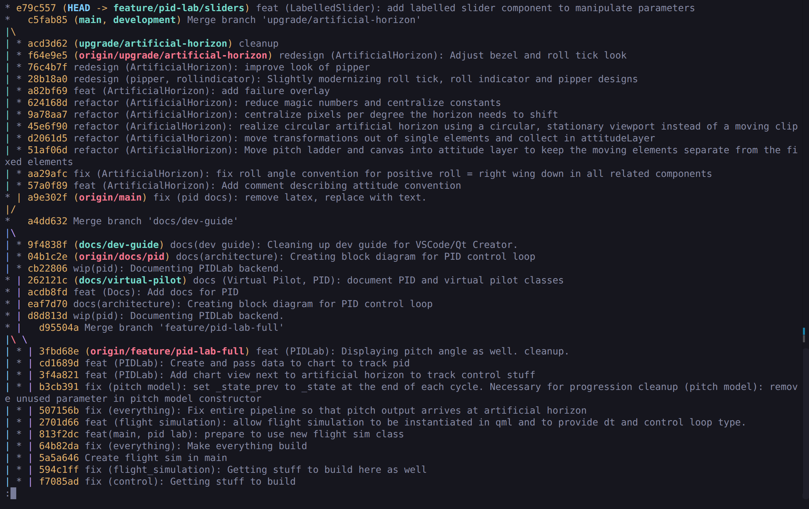
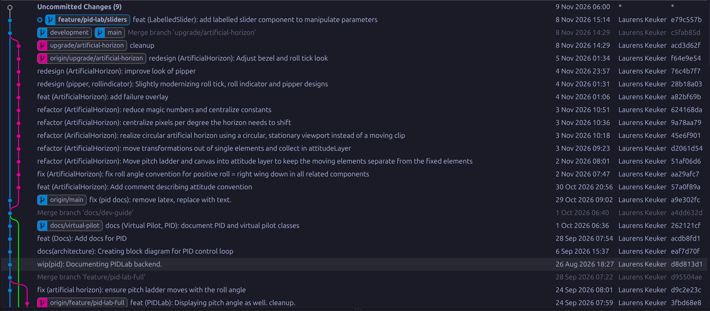

In this post, I will present some of the Git commands that I have come to use regurlarly in my day to day work. I am anything but a Git power user, but I am working to change that, command by command. And along with my Git skills, this post will grow, command by command. I hope that it will also help you towards becoming a more confident Git user!

### Amending a Commit

Messed Up a Commit?

```bash
git commit --amend
```

Let's say you just committed some meaningful work that you are very proud of. Now you would like to push it to your repo and share it with everyone. But what's that? You called that one variable `youre_variable` instead of `your_variable`? Left in some obscure debugging output? And that line is indented one space too far! That's terrible. You don't want everyone to know about that by creating a new commit with an explicit message and explicit changes, basically displaying your concentration lapses to everyone on a silver platter! (More importantly, it can lead to a cluttered Git history.)

`git commit --amend` is here for you. It re-opens the previous commit you made and lets you add to it. First, fix what you would like to fix and stage those changes. Then `git commit --amend`. You will now also get the chance to edit the commit message of the last commit. Once this is saved, your fixes are now contained in the previous commit! Of course, you can also directly `git commit --amend -m "Updated commit message"`. However I always prefer the former, as I get to see again what my previous commit's message was, making sure I'm not overwriting anything important.

**Note** If you have already pushed the commit you would like to amend and then try pushing the amended commit, Git will prompt you to pull first, because your local and remote branches have diverged. This makes sense, because now your most recent commit has changes that remote does not have. You could force push, but of course that is never advisable if multiple people are working on your branch. So think before you push 😁

### Easy Switching Between Branches

Forgot the Previous Branch's Name?

```bash
git checkout -
```

Naming things in a descriptive way is very important. However this can cause a bit of a headache when working with very descriptively named Git branches. Suppose you named your feature branch `feature/a-very-specific-feature-brach-name`, and quickly had to switch to `main` to inspect something. Check over, lets head back to your feature branch. What was it called again? `feature/very-specific-feature-brach-name`? Or `feature/a-very-specific-brach-name`? I struggle with this after a few hours of work. Of course you could just `git branch` every time, to list all the branch names in your local Git repo. But then you need to look for your branch name and type it into the console each time. 

This is where `git checkout -` comes in. Can you guess what it does? That's right! It simply and quickly checks out the branch you were on before heading over to `main`. Forgot some detail of what you had just inspected in `main`? Jump right back over there with `git checkout -`. As you can see, this is an incredibly useful and time-saving command, especially when regularly switching between branches. It also greatly reduces brain fatigue experienced when trying to remember a bunch of branch names, in addition to juggling function and variable names from your actual program. Every little bit helps!

### Viewing Your Changes

Forgot to Commit Your Code Yesterday?

If you're like me, you'll have totally forgotten what code you wrote since the previous commit. This command will get your memory back up to speed: 

```bash
git diff
```

It will show you the "diff"-erence between your previous commit and the changes you made since then. Diffs are a core Git concept and there's a lot more to them than that. But for a quick check of what you have been dabbling in since the last commit, it does the trick - as long as the changes are still in the working directory, and have not been staged yet. 

If you need the diff between your staged changes and the previous commit, this flag is your savior: 

```bash
git diff --cached
```

And if you did commit your code yesterday, but simply forgot what the last completed task was, you can take a look at the diff between your previous commit and the one before that like this: 

```bash
git diff HEAD HEAD~1
```

`HEAD` references the most recent Git commit on the branch that you're on, and `HEAD~1` references that commit's immediate parent.

### Resetting Changes

Broke Some Code, But Your Boss Didn't Like That?

The notorious `git reset` is your friend! It's that one friend that can also give you a headache. However, if we know the friend well, we can get around that.

The quick way is to simply use `git reset --hard` and everything you changed since the last commit is undone. But what if you already committed the broken code?
Luckily, there is a way to undo this as well. That way is: `git reset --hard HEAD~1`. But before happily resetting everything, please read on!

What is `HEAD~1`? Remember the `git diff` section? `HEAD` is a pointer to your current commit, and `HEAD~1` is pointing to this commit's parent, i.e. the commit that came before the current commit. 
Using this as part of the git reset command moves the `HEAD` pointer back to your previous commit.
 
But that's the brutal way, bringing your code back to the state of the previous commit. All the changes in the most recent commit are gone, even if there were any that you wanted to keep.

Fortunately, there is a more nuanced way we can go about this.

Those are the soft, mixed, or hard ways. Here's a quick rundown of what each of them means.

```sh
git reset --soft HEAD~1
```

Simply undoes the commit itself. All the broken code (and all changes in general) you created since the last commit is still there and staged, but not part of a commit.

```sh
git reset --mixed HEAD~1
```

Undoes the commit and unstages the last commit's code. This is what Git applies if you type git reset as well. This way, you can delete all the faulty code and keep what you want to keep. 

```sh
git reset --hard HEAD~1
```

Undoes all changes of the last commit. This one is called “hard” because you should think really hard before using this command. It's usually safer to simply use git reset.

Of course, if you would like to reset to older commits, replace `HEAD~1` by `HEAD~x`, x being the amount of commits you want to reset.

If you omit the `HEAD~1`, the same applies, however without shifting the `HEAD` pointer (i.e. without moving you back to your previous commit): 

```sh
git reset --soft
```
Doesn't do anything. Staged changes remain staged, the working directory remains in its current state.

```sh
git reset --mixed
```

Unstages any staged code.

```sh
git reset --hard
```
Unstages and removes any changes from the working directory.

>If you're busy working with Git commands, never Up Arrow + Enter without thinking. It has caused me significant pain and I hope to be able to spare you some of that!
{: .prompt-tip}

### Finding Error-Introducing Commits

I'm sure you have experienced the following: You were coding away at a project or at work, building step by step, and then, you remember to run your tests after having forgotten for a couple of commits. Now, a feature that had worked a while ago is broken. You wonder when that happened. It was working perfectly well, and now it is not.

That is what `git bisect` is for. In essence, you provide a commit when your feature was working (e.g. before a rebase, or at the last version tag), and the current commit (where it is not working), and then git leads you through a binary search through your history until you have found the error-introducing commit. As with binary search, git then checks out a commit half way between working and broken and asks you to tell it if this intermediate commit is working. If yes, search the second half of commits, if no, the first half. And then, the two of you continue to search in this way until the culprit is found.

Use is really simple. Start the search with 

```bash
git bisect start
```
Then type

```bash
git bisect bad
```

to mark the current commit as broken. Then, find a working commit and mark it as such: 

```bash
git bisect good v2.1.3
```

or using any other version of referencing commits. Git will respond by checking out a commit in the middle between the good and the bad commit and outputs something like 

```bash
Bisecting: 123 revisions left to test (roughly x steps)
```

Then, go ahead and build/test/whatever you need to do to find out if this commit is functional and mark it as good or bad as above (no need to provide any commit hashes). Once the search is finished, you will have checked out the first bad commit. To move back to your current working state, use 

```bash
git bisect reset
```

For reference, check out the full documentation.


### Changing the Config

Git stores configuration globally for your user or locally for a single repository. Use `--global` for settings that should apply to all your repositories, or leave it out to change only the current repository:

```bash
git config --global user.name "Your Name"
git config --global user.email "you@example.com"
git config user.email "work@example.com"
```

You can inspect your settings with `git config --list --show-origin`, or open the global config file directly with `git config --global --edit`. You can do some cool things with the config, e.g. aliases. These allow you to type e.g. `co` instead of `checkout`, or whatever you can fathom. Git aliases go in the `[alias]` section of that file:

```ini
[alias]
  co = checkout
```

Now `git co main` is shorthand for `git checkout main`. You can also add an alias from the command line, for example `git config --global alias.co checkout`.

Some other things you could do in the config:

+ Choose the default branch name for newly initialized repositories:

```bash
git config --global init.defaultBranch main
```

+ Remove stale remote-tracking branches whenever you fetch:

```bash
git config --global fetch.prune true
```

### Useful aliases

*`git adog`*

Who doesn't like a dog? Especially when trying to understand what is going on in their git history in a slightly more visual way than just using git log. __adog__ in this case is shorthand for 
`--all --decorate --oneline --graph`.

Here is an excerpt of the history of my Flight Laboratory project displayed with `git adog`:



### Useful Extensions

Now while using the command line to control git is the way to go for me, there are a couple of useful VSCode extensions that make life a little easier.

**Git Graph**

While `git adog` helps with visualization of git history, reading its output takes some getting used to. Enter _Git Graph_. It can visualize git history in the same way, but interactively, and in its own VSCode window. Additionally, it allows you to do basically anything you can also do from the command line, with the visuals right there (e.g. merge, rebase, cherry-pick, push, fetch, you name it). Especially when doing complex history reconciliation, it can be quite helpful.

Here is an excerpt of the history of my Flight Laboratory project displayed with Git Graph: 



**Git Lens**

_GitLens_ adds Git information directly to your editor. It can show who last changed a line and when, browse file and branch history, and compare revisions without leaving VSCode. It is especially useful when you want context for a piece of code without switching back to the terminal. If any questions come up about who wrote a piece of code that you don't understand: Git Lens knows.
