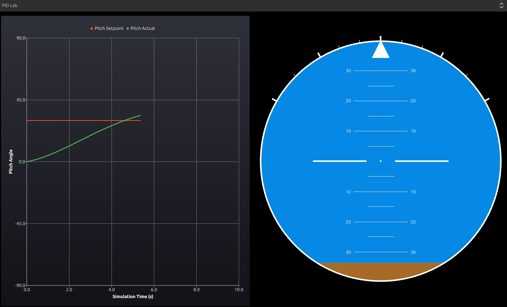
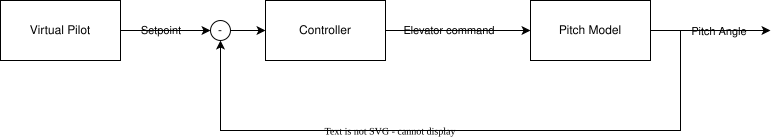

>## TL/DR
>
> - I wanted some hands-on control experience, because until now my control work had mostly been theoretical.
> - I built a simple pitch-angle PID loop in the Flight Laboratory GUI to finally get a real controller working.
> - A virtual pilot generates a pitch step setpoint, the controller compares it to the actual pitch, and commands the elevator.
> - A simple pitch model simulates the aircraft response
> - This is intentionally basic, but it is a solid first step toward more realistic GNC and autopilot development later on.
> {: .prompt-tip}

So. Now that I upgraded my rusty Qt-skills a little bit, we come to the part that formed a central motivation for this project. 

I love GNC (as recounted). Yet, I have only gotten really deep into state estimation. Localization, mapping, attitude estimation and the lot. I also have some experience with perception, having build my master's thesis around lidar-based object detection. I even have some basic path planning experience, that came from a web-app I built to learn about the basics, **A\*** and the lot (see [Projects](../_tabs/projects.md)). 

However, I never gained any practical control experience. All I ever controlled was a fictional plant on my sheet of paper in my control theory exams. And, well, the PID was one of the simplest controllers I had learned about wayyy back. Since then, I have learned about LQR, cascaded controllers, TECS controllers and the lot. But never have I ever implemented or tuned a PID.

As the Flight Laboratory project is meant to be a project to learn everything and anything about GNC and aviation, the sky being the limit (haha), I decided to construct the GUI as a collection of presets. Meaning, you can select a topic you want to learn about or build on in a drop-down menu, and an according GUI, with according instruments and displays, opens up.

# PID Lab

So I decided that the first preset should be called "PID Lab". I had a visualizer (the artificial horizon), now I basically needed to build a control loop under the hood, using the C++ back end. I chose that, for now and to keep it simple, I would simply control just one attitude value, the pitch angle, using a PID controller. Now that might not necessarily be how Airbus autopilots control their planes' pitch angle, but that's how Laurens controls his GUI's pitch angle. After all, he needs to start somewhere. 

To make things more scientific and more quantifyable, I decided to add a graph of setpoint and actual pitch angle.

From a systems-standpoint, I constructed the control loop like this: 

I will not provide an in-depth overview of the calculations et. here, so For in-depth functionality and calculations, please refer to the [project's documentation](https://llke.github.io/flight-laboratory/).

## Virtual Pilot

To start, I implemented a "virtual pilot" base class. What does this do? Well, it's just software pretending to be a pilot. In my case, I only have one variant of the virtual pilot: the "Pitch Step Pilot". It does nothing more than generate a step in the pitch setpoint with a given magnitude. I plan to use this class for more complex piloting in future, but this is the starting point. It is what generates the orange line in the picture above.

## Controller

Then comes the actual controller. It is fed the control error, i.e. the difference between the setpoint and the current pitch angle. From this, it calculates the command for the virtual actuator that control's the virtual plane's pitch angle: the elevator. 

## Pitch Model

Based on the output that the controller provides for the elevator, a simple pitch model calculates the pitch angle that would result from this elevator deflection on a very-simple-physics-obeying plane. This simulates the actual plane. And the output of this model is then the "measurement", i.e. the actual pitch angle that is fed back to determine the control error. This is visualized as the green line in the picture above. 

Of course, a real life measurement would still have a measurement error, but those kinds of increases in complexity will come later. 